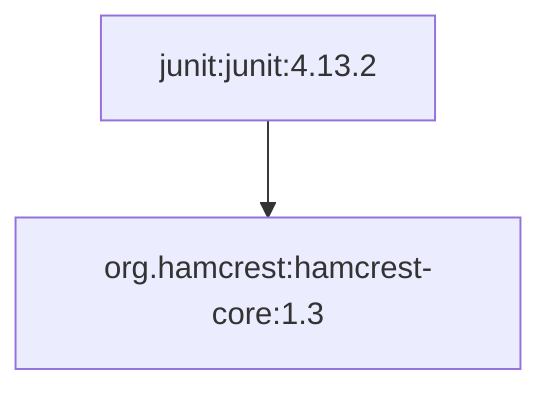
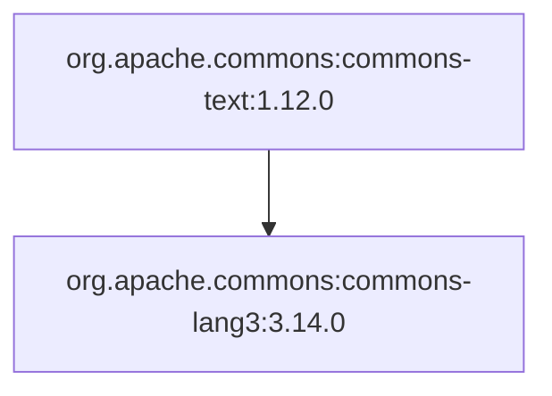
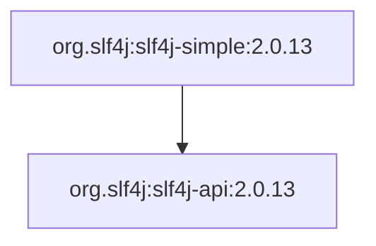

# Граф зависимостей Maven — вариант № 9

Инструмент читает Maven POM по HTTP(S) средствами стандартной библиотеки
Python 3.9+. Установка Python-пакетов не требуется. Maven и JDK нужны только
для независимого сравнения.

```bash
python3 src/main.py --package A --version 1.0 --test \
  --repo examples/diamond.txt --ascii
python3 -m unittest discover -s tests -v
```

Без `--ascii` программа печатает Mermaid (`flowchart TD`). В Markdown
вставьте этот текст в блок с языком `mermaid`. Ориентация рёбер:
пакет → его зависимость. Метки ASCII: `[shared]` — уже показанный узел,
`[cycle]` — ссылка на узел текущей ветки. Диагностика циклов идёт в stderr.

В тестовом репозитории строка `A: B C` объявляет пакет A с зависимостями B
и C. Строка `A:` задаёт пакет без зависимостей. Версия тестовых пакетов —
`1.0`. Имена — одиночные заглавные латинские буквы.

Команды по этапам, результаты и подсказки для защиты: [DEFENSE.md](DEFENSE.md).
Результаты проверки и исправления: [REVIEW.md](REVIEW.md).
После клонирования с GitHub этапы открываются командами
`git switch --detach origin/stage-1` …
`git switch --detach origin/stage-5`. Это отдельные ветки, а не Git-метки.
Вернуться к итоговой версии: `git switch main`.

Три примера из Maven Central:

```bash
repo=https://repo.maven.apache.org/maven2
python3 src/main.py --package junit:junit --version 4.13.2 --repo "$repo"
python3 src/main.py --package org.apache.commons:commons-text --version 1.12.0 --repo "$repo"
python3 src/main.py --package org.slf4j:slf4j-simple --version 2.0.13 --repo "$repo"
sh examples/compare-maven.sh junit tree
sh examples/compare-maven.sh text tree
sh examples/compare-maven.sh slf4j tree
```

Анализатор ориентирован на JAR с фиксированными версиями, доступными в
одном репозитории. Поддерживает базовые свойства, наследование POM и
управляемые версии из `dependencyManagement`, включая импорт BOM. Граф показывает
зависимости compile/runtime самого корня и не распространяет optional
через промежуточный пакет. Maven используется в режиме потребителя:
optional-зависимости выбранной библиотеки в такой проверке исключаются.
Также полноценный Maven учитывает профили, исключения,
конфликты версий и другие правила, которые анализатор не реализует.
На сложных проектах возможны отличия или ошибка при неразрешённой версии.

## Запуск с нуля

В обычном Терминале Mac выполните:

```bash
git clone https://github.com/Daylolot/ConfUpravPrakt2.git
cd ConfUpravPrakt2
python3 --version
python3 src/main.py --help
```

Компиляция и установка Python-библиотек не нужны. Для интернет-примеров
нужно соединение с Maven Central; тестовые графы и тесты работают без него.

| Параметр | Пример | Что задаёт |
| --- | --- | --- |
| `--package` | `junit:junit` или `A` | Maven-координаты или имя тестового узла |
| `--repo` | `https://repo.maven.apache.org/maven2` | URL репозитория; с `--test` — файл графа |
| `--version` | `4.13.2` или `1.0` | Фиксированную версию пакета |
| `--test` | Без значения | Работу с тестовым файлом |
| `--ascii` | Без значения | Вывод ASCII вместо Mermaid |

`--test false` и `--ascii yes` — ошибки: это флаги без значений.
Первые три параметра обязательны. Коды завершения: 0 — успех, 1 — ошибка
данных/сети, 2 — ошибка параметров. В режиме визуализации найденный цикл
сохраняется в графе и выводится в stderr, а команда заканчивается кодом 0.
На этапе 4 цикл запрещает корректный порядок и приводит к коду 1.

## Структура и проверки

| Путь | Назначение |
| --- | --- |
| `src/main.py` | CLI и выбор источника данных |
| `src/maven.py` | Скачивание POM, свойства, наследование, BOM |
| `src/graph.py` | Тестовый репозиторий, рекурсивный DFS и циклы |
| `src/render.py` | Mermaid и ASCII |
| `tests/` | 21 тестовый метод, включая регрессии ревью |
| `examples/visualizations/` | Результаты для трёх реальных пакетов |
| `examples/compare-maven.sh` | Независимая проверка штатным Maven |
| `examples/reference/` | Сохранённые журналы сравнения с Maven |

Проверки запускаются командой `python3 -m unittest discover -s tests -v`.
Тесты покрывают параметры CLI, HTTP-загрузку конкретной версии с локального
сервера, ошибки XML/сети, переопределение свойств родителя, BOM,
DFS, циклы, общие зависимости и оба формата вывода.
В исходниках и тестах Python нет строк длиннее 80 символов; документация
классов и функций оформлена docstring.

## Визуализации

Ниже приведён фактический вывод программы для выбранных версий.
Тексты Mermaid и ASCII также сохранены в `examples/visualizations/`.

### JUnit 4.13.2



### Commons Text 1.12.0



### SLF4J Simple 2.0.13



В этой работе показывается граф объявленных зависимостей compile/runtime.
Если разные ветви ссылаются на разные версии одного артефакта, они
остаются разными узлами. Полная стратегия Maven nearest-wins не реализована.
Рёбра `exclusions` и зависимости из профилей пока не учитываются.
Поэтому инструмент нельзя выдавать за полную замену Maven Resolver.
